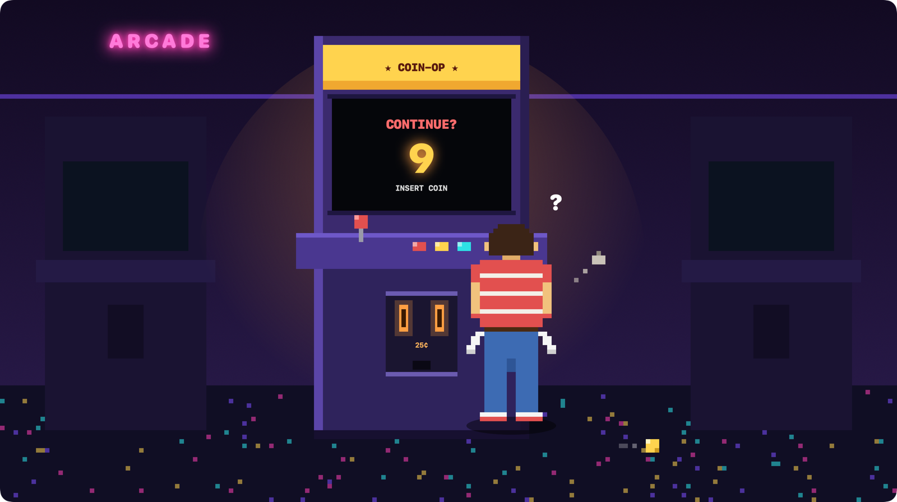
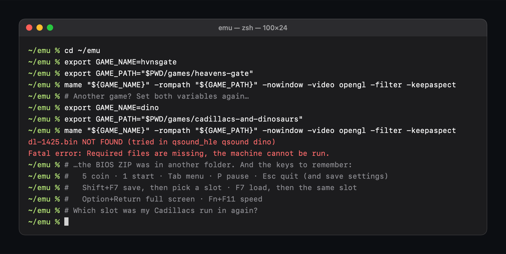
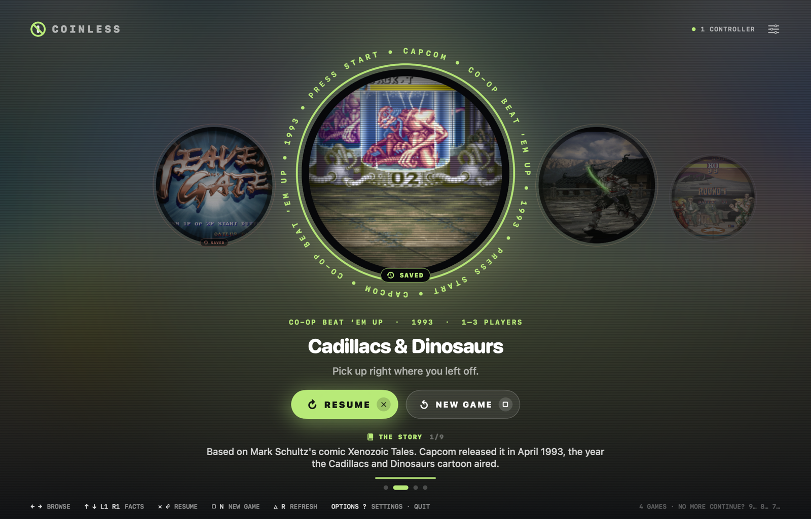

# Coinless

*No more CONTINUE? 9… 8… 7…*

**[Read the story →](https://alchemication.github.io/coinless/)**

Coinless is a native Mac front end for [MAME](https://www.mamedev.org/), made for playing arcade games from the couch. It keeps everything we loved about the arcade (the glowing cabinets, the attract screens, the marquees, the stories) and loses only the coin slot.

### Insert coin



The arcade: one cabinet, one game, and a countdown racing through your pockets. We loved every second of it.

### Type a command



MAME at home, from Terminal: two variables and a long command per game, a dozen keys to remember, save slots to keep track of, and cryptic errors when a BIOS file is in the wrong folder.

### Press start



- **Your place, waiting.** A saved game shows the exact moment you left it. Press ✕ to resume; quit normally and it's saved again. No slots to remember.
- **Real pictures, made by MAME.** Every round CRT screen shows the game itself, captured from its attract mode in the background.
- **Stories behind the games.** Under the Play button, short, sourced facts turn over on their own: who made it and why, trivia, tips and combos. The marquee names the developer.
- **Made for the couch.** Everything works from a PS4 controller, settings included. Big type that reads from across the room.
- **Nothing to set up per game.** BIOS files are found automatically, and a missing one is named in plain words before MAME even starts.
- **Hard to lose progress.** Starting over takes two presses and keeps a backup; quitting the app mid-game still saves.
- **Console classics too.** MAME's Super Nintendo runs beside the arcade, with a pad layout that matches the SNES by position. *Zelda: A Link to the Past* is the first.
- **Terminal too.** `./play dino` uses the same settings and saves, and shows the MAME command it runs.

Coinless ships no games. You add the ones you want, using game files you have the right to use.

## Setup

First, get the code:

```sh
git clone https://github.com/Alchemication/coinless.git
cd coinless
```

**With a coding agent (easiest).** Open the `coinless` folder in Claude Code, Codex or another coding agent and say:

> Set up Coinless

then, for each game:

> Add Final Fight

The agent follows the project's skills (`.claude/skills/`): `setup` checks MAME and Apple's tools and builds the app; `add-game` finds the right MAME set, tells you which ZIPs to provide, verifies them, and adds pictures, facts and tips.

**By hand.**

```sh
brew install mame                     # needs Homebrew: https://brew.sh
xcode-select --install                # if `xcrun swiftc` is missing
zsh launcher/build.sh                 # builds, signs and checks Coinless.app
./play --inspect "final fight"        # which ZIPs a game needs
open Coinless.app
```

Put each game's ZIP in `games/<folder>/` and BIOS or device ZIPs in `games/bios/`; [docs/games.md](docs/games.md) lists the catalog and explains adding new games. Keep `Coinless.app` in the project folder; drag it to the Dock for one-click access.

## Controls

| Action | PS4 controller | Keyboard | Mouse / trackpad |
| --- | --- | --- | --- |
| Browse | D-pad or left stick | ← → | Swipe; click a side game |
| Play / Resume | ✕ | Return | Click the centre game |
| New game (on a saved game) | □, twice | N, twice | **New game**, twice |
| Next fact (optional) | ↓ ↑ or R1 L1 | ↓ ↑ | Click the fact |
| Settings | Options | ? or ⌘, | Sliders, top right |
| Refresh the library | △ | R | Settings → Refresh games |
| Back to the library (in a game) | Hold Options + Share | Esc | |
| Quit Coinless | Options, then **Quit Coinless** | ⌘Q | Settings → **Quit Coinless** |

**In a game:** the pad and the keyboard both work from the start: □ ✕ ○ △ L1 R1 (attack □, jump ✕) or A S D F G H, Options to start, Share for a coin; player 2 on a second pad (or Q W E R T Y and I J K L). Layouts per game are in [docs/games.md](docs/games.md#controls); remap in MAME's menu (Tab) and your change wins.

**Back to the library from the couch:** hold **Options + Share** for a moment during a game. It quits like a normal exit, so saving works as usual. Esc works on the keyboard.

**Sound:** seventeen original themes drift into one another on the library and fade out while you play, with soft sounds as you browse and start games. *High Score* opens; then today's theme takes over, the soft original by day and its night version from 6 pm (piano in the rain, a music box, a choir and a ticking clock…). The top bar shows what's playing; Settings has ← → for another theme; `./play --sounds` plays them all.

**TV:** mirror the display, or make the TV the main display before opening Coinless; games open on the main display.

## Saves

For games MAME can save (`./play` shows which), **quit normally** and your place is saved to `sta/<game>/auto.sta` (`sta/<game>/snes/auto.sta` for a Super Nintendo game, whose own in-game saves are in `nvram/snes/`); next time, **Resume**. New game keeps the old save as `auto.sta.bak`. Quitting Coinless mid-game still saves. Turn saving off in Settings.

For saves during play, set **Save State (Quick)** and **Load State (Quick)** in MAME's User Interface list, e.g. L3 and R3.

Back up `cfg/`, `nvram/` and `sta/` yourself; Git doesn't hold them.

## Terminal

```sh
./play                       # your games, what's missing, which have saves
./play dino                  # play (names can be shortened: ./play cad)
./play sf2ce --style crt     # smooth, sharp or crt; also --window, --fresh, --no-save
./play --facts tekken3       # every fact, with sources
./play --inspect mslug       # what MAME needs for a game
./play --check               # check MAME, the catalog and your files
./play --sounds              # hear the interface sounds and all the music themes
./play --help                # everything else
```

## Troubleshooting

- **A game is missing:** `./play` shows the expected file and any missing BIOS, then refresh with △ or R.
- **MAME says files are missing:** `mame <id> -rompath "games/<folder>;games/bios" -verifyroms`.
- **A game closes with an error:** Coinless shows why; the full output is in `launcher/.build/mame-last.log`.
- **The controller stops responding after a game:** press any button within 20 seconds, or click the Coinless window.

## Licence

MIT (see [LICENSE](LICENSE)). Coinless contains no MAME code: it runs your separately installed `mame`, which has its own [licence](https://docs.mamedev.org/license.html). It includes no ROMs, BIOS files or games; obtaining them, and the right to use them, is up to you. The screenshots above show game artwork for illustration, and the site's faint background ghosts are sprites and portraits from 38 classic arcade games, © their makers, shown as a tribute. Facts are short summaries that link to their sources.

Working on Coinless itself? [CLAUDE.md](CLAUDE.md) has the layout, rules and checks.
